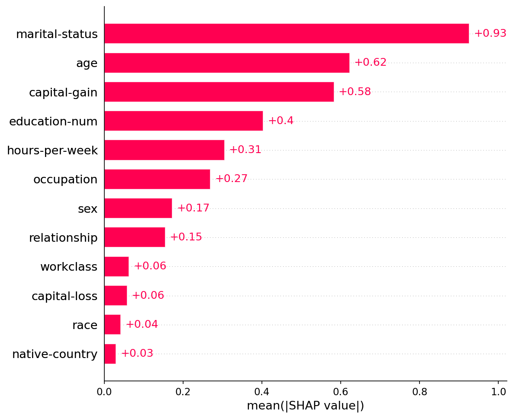
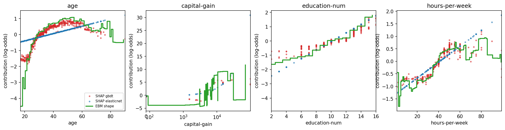
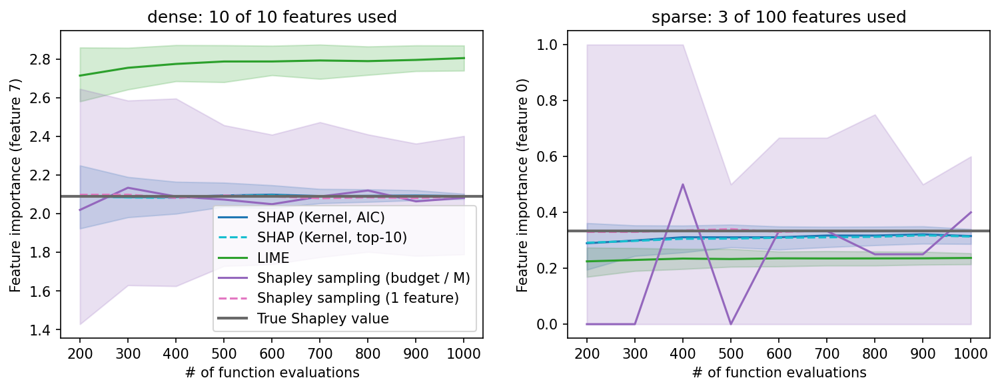

# Interpretable Regression & Explainability trên dữ liệu Adult

**Bản đọc chéo ngày 27/11/2026 — nguồn Markdown cho báo cáo cuối kỳ.**

**Học phần:** Machine Learning and Applications — Topic 1.  
**Nhóm:** Đinh Trương Tuệ Linh (2570441), Đinh Thị Thu Thủy (2570508), Hứa Phước Trường (2580869).

> Bản thảo nguồn để nhóm học, đọc chéo và biên soạn báo cáo PDF 8–12 trang theo mục 5.1. Số liệu dưới đây thuộc artifact thực nghiệm của Thủy đã được merge về repository. Kiểm tra tính lại metric từ dự đoán không được xem là huấn luyện lại. Nhật ký chạy mới phải được trích riêng. Chưa xác nhận ngày nộp proposal, tỷ lệ đóng góp và hình thức trình bày; không điền giả các thông tin này.

## Tóm tắt

Nghiên cứu so sánh Logistic Regression với L1, L2, Elastic Net và GBDT trên Adult, kết hợp hệ số mô hình với giải thích SHAP. Các mô hình chính dùng 5-fold cross-validation, 12 cấu hình cho mỗi biến thể và ba random seed. Trong artifact của nhóm, GBDT đạt test ROC-AUC khoảng 0.9270 so với khoảng 0.9033–0.9035 của Logistic. Regularization thay đổi độ thưa rõ hơn hiệu năng. EBM được khảo sát bổ sung như một mô hình cộng tính phi tuyến; kết quả gần GBDT về mặt số học nhưng chưa chứng minh tương đương thống kê hoặc tính dễ hiểu đối với người dùng. Thí nghiệm SHAP trên bài toán nhỏ và cây tổng hợp minh họa local accuracy và hiệu quả mẫu dưới các giả định được công bố. Kết luận giới hạn trong dataset và protocol đã đo.

### Phân biệt artifact gốc và nhật ký chạy lại

Bản thảo trước ghi nhận lần chạy `section4-baseline-20261126`. Trong lượt đọc chéo này, thư mục tồn tại nhưng quyền truy cập không cho phép đọc lại `baseline/test_metrics.csv`; vì vậy không dùng các số liệu chạy lại đó làm bằng chứng vừa được xác minh. Các kết quả chính bên dưới thuộc artifact đã lưu của nhóm. Sáu metric từ 21 tệp dự đoán tuning đã được tính lại thành công ở lượt đọc chéo này, với sai số cho phép 1e-10; kết quả kiểm chứng nằm trong [evidence_review.md](evidence_review.md). Đây là kiểm tra dự đoán có sẵn, không phải huấn luyện lại.

## 1. Introduction

### 1.1. Bài toán và động cơ

Dữ liệu Adult được dùng để dự đoán nhãn thu nhập `>50K` từ các đặc trưng nhân khẩu học và công việc. Đây là phân loại nhị phân, phù hợp với Logistic Regression được nêu trong Topic 1. Mục tiêu học thuật không chỉ là tối đa hóa accuracy: nhóm cần hiểu mô hình sử dụng đặc trưng nào, vì sao các mô hình khác nhau và khi nào lời giải thích có thể thiếu ổn định. Dataset không được coi là bằng chứng cho khả năng triển khai quyết định đối với con người ngoài thực tế.

### 1.2. Các hướng tiếp cận và câu hỏi nghiên cứu

| Hướng | Ưu điểm | Giới hạn |
| --- | --- | --- |
| Logistic có regularization | Hàm dự đoán gọn, đọc hệ số và odds ratio; L1/Elastic Net có thể tạo nghiệm thưa | Tuyến tính trên log-odds; quan hệ phi tuyến cần thiết kế thêm đặc trưng |
| GBDT + SHAP | Học được quan hệ phi tuyến; khảo sát đóng góp theo từng quan sát | Ensemble khó đọc toàn bộ; attribution phụ thuộc cách định nghĩa giá trị nền/đặc trưng vắng mặt |
| EBM/GAM, GA2M | Biểu diễn bằng hàm một biến và một số tương tác | Nhiều hàm/bin vẫn cần người đọc kiểm tra; chi phí fit và kích thước không nhất thiết nhỏ |

Các câu hỏi nghiên cứu và bằng chứng được tổ chức như sau:

| Câu hỏi | Thí nghiệm trả lời | Phạm vi kết luận |
| --- | --- | --- |
| RQ1. GBDT cải thiện hiệu năng so với Logistic bao nhiêu? | Tuning ba seed; paired bootstrap test | Adult, các grid và split đã xét |
| RQ2. Penalty ảnh hưởng hiệu năng và độ thưa thế nào? | Ablation C=1, cùng pipeline | So loại penalty tại một C; không so với mô hình không regularization |
| RQ3. Hệ số/SHAP khác nhau ở đâu và ổn định đến đâu? | Coefficient, global/local SHAP, bootstrap train | Giải thích hành vi mô hình; ổn định global có điều kiện |
| RQ4 (mở rộng). EBM và phân tích nhóm bổ sung gì cho đánh đổi accuracy–interpretability? | GAM/GA2M, dependence, group metrics | Thăm dò cấu trúc và khác biệt nhóm; chưa đo khả năng hiểu của người dùng |

 Paper SHAP [1] là tài liệu tái hiện; InterpretML [2] cung cấp hướng mở rộng EBM. Nhóm phân biệt việc áp dụng SHAP trên Adult với tái hiện thí nghiệm của paper.

## 2. Methods / Approaches

### 2.1. Logistic Regression và regularization

Với $p_i=\sigma(b+x_i^T\beta)$, mục tiêu lý thuyết:

$$
\min_{b,\beta}-\frac{1}{n}\sum_i\{y_i\log p_i+(1-y_i)\log(1-p_i)\}
+\lambda\left(\alpha\|\beta\|_1+\frac{1-\alpha}{2}\|\beta\|_2^2\right).
$$

L1 ứng với $\alpha=1$, L2 ứng với $\alpha=0$, Elastic Net dùng giá trị trung gian; intercept không bị phạt. SAGA tối ưu mục tiêu bằng cập nhật gradient có giảm phương sai, xử lý thành phần L1 bằng bước proximal. `C` nhỏ làm regularization mạnh hơn; khi đối chiếu $\lambda$ cần giữ đúng cách chuẩn hóa loss của thư viện [3], không mặc định mọi biểu thức phần mềm đều dùng $\lambda=1/C$.

Hệ số biến số được đọc theo một độ lệch chuẩn train. Hệ số one-hot được đọc so với nhóm tham chiếu. Khi các biến khác giữ nguyên, odds nhân với $\exp(\beta_j)$ khi biến tăng một đơn vị. Đây là quan hệ trong mô hình, không phải kết luận nhân quả. Hệ số lớn không tự đồng nghĩa tầm quan trọng dự đoán lớn nếu đơn vị/phân bố biến khác nhau.

### 2.2. GBDT

GBDT xây dựng hàm điểm $F_T(x)=F_0+\eta\sum_{t=1}^{T}h_t(x)$; các cây được bổ sung theo hướng giảm loss, với xác suất lớp dương lấy qua sigmoid. Độ sâu cây, số cây và learning rate điều khiển độ phức tạp. So với Logistic không có đặc trưng tương tác, cây có thể biểu diễn ngưỡng và tương tác. So sánh hiệu năng chỉ gợi ý lợi ích của biểu diễn này, chưa tách được riêng tác động của từng thành phần.

### 2.3. SHAP và tái hiện

Với $N$ là tập đặc trưng và $v_x(S)$ là đầu ra kỳ vọng theo cách masking đã chọn, attribution Shapley là:

$$
\phi_j(x)=\sum_{S\subseteq N\setminus\{j\}}\frac{|S|!(M-|S|-1)!}{M!}\big[v_x(S\cup\{j\})-v_x(S)\big],\qquad F(x)=\phi_0+\sum_j\phi_j(x).
$$

Trong thí nghiệm Adult, TreeExplainer dùng interventional/raw và LinearExplainer dùng background độc lập; đầu ra được đối chiếu với decision_function. Với Logistic, $\phi_j=\beta_j(z_j-\bar z_{j,bg})$, nên hệ số dương vẫn có thể cho SHAP âm khi giá trị thấp hơn trung bình background. Global importance theo biến gốc $g$ là $I_g=n^{-1}\sum_i|\sum_{j\in g}\phi_j(x_i)|$. Chỉ áp dụng sigmoid sau khi cộng base value và mọi attribution; không coi một SHAP value là thay đổi xác suất.

SHAP biểu diễn một dự đoán thành giá trị nền và tổng attribution. Nhóm giải thích GBDT/Logistic trên thang raw log-odds, kiểm tra sai số cộng tính và tổng hợp các cột one-hot theo biến gốc. Thí nghiệm paper gồm Figure 3 trên cây tổng hợp và Figure 4 trên hai trò chơi nhỏ. Cách tạo dữ liệu, reference và cách phân chia ngân sách sampling phải ghi riêng vì không đồng nhất hoàn toàn với paper [1]. Tổng attribution đúng không tự chứng minh mô hình dự đoán đúng hoặc lời giải thích mang ý nghĩa nhân quả.

### 2.4. EBM và kiểm tra ổn định

EBM được khảo sát với cấu trúc cộng tính $F(x)=b+\sum_j f_j(x_j)$ và phiên bản thêm hàm cặp $\sum_{j,k}f_{jk}(x_j,x_k)$. Hai cấu hình GAM/GA2M giúp khảo sát biểu diễn phi tuyến có thể đọc theo term [2]. Bootstrap train 30 lần đo thay đổi hệ số và thứ hạng SHAP khi refit với hyperparameter cố định; bootstrap test 1.000 lần đo chênh lệch metric có điều kiện trên các mô hình đã fit. Hai phép bootstrap trả lời hai câu hỏi khác nhau.

## 3. Experiments

### 3.1. Dữ liệu và chống rò rỉ

Artifact `data_check-1` ghi 32.561 mẫu train và 16.281 mẫu test từ tệp chính thức của Adult [4]. Nhãn dương lần lượt 7.841 và 3.846. Nhóm giữ bản ghi trùng (24 train, 5 test), bỏ `fnlwgt` và `education`, giữ `education-num`. Dữ liệu thiếu được impute median/mode; one-hot cho biến phân loại; Logistic chuẩn hóa biến số. Mỗi transformer được fit bên trong training fold. Giữ bản ghi trùng có thể tạo phụ thuộc giữa các fold; kết quả CV phải được diễn giải với giới hạn này.

Test độc lập với tuning. Validation là fold giữ lại trong Stratified 5-fold CV trên train. Seed 42, 2026, 5175 được dùng chung giữa mô hình. Khi tuning xong, refit toàn train và đánh giá test với threshold 0.5. Trong code tuning, test không tham gia GridSearchCV hoặc chọn best_params. Các mở rộng được bổ sung sau khi đã xem kết quả phải được xem là thăm dò; không khẳng định toàn bộ quá trình nghiên cứu chưa từng sử dụng phản hồi từ test.

### 3.2. Baseline, ngân sách và môi trường

Baseline Logistic L2 `C=1` kiểm tra pipeline trước tuning, đạt test ROC-AUC xấp xỉ 0.9033 trong artifact `baseline-1`. Các mô hình chính thử 12 cấu hình × 5 fold mỗi seed: L1/L2 dùng 12 C log-spaced từ 0.001 đến 100; Elastic Net thử C ∈ {0.01, 0.1, 1, 10} và l1_ratio ∈ {0.2, 0.5, 0.8}; GBDT thử số cây {100, 200}, learning rate {0.03, 0.1}, độ sâu {2, 3, 4}. Chọn bằng ROC-AUC CV. Mỗi biến thể có ngân sách tương đương theo số lần fit; tổng ba biến thể Logistic không bằng một GBDT về ngân sách họ mô hình.

Artifact gốc ghi Ubuntu runner, 4 CPU, khoảng 15.6 GB RAM, Python 3.10, scikit-learn 1.7.2. Bản ghi đầy đủ nằm ở `env.json` của từng artifact. Thời gian tuning/refit/inference tách riêng. Số hệ số Logistic, số nút/lá GBDT và số term/bin EBM là các cách đếm khác nhau, không dùng chúng như một thước đo tham số đồng nhất.

### 3.3. Kết quả chính và sai số

Bảng đầy đủ sáu metric, mean ± sample std ba seed, được sinh từ CSV ở [evidence.md](evidence.md); script tính lại metric từ các dự đoán đã lưu và dừng nếu phát hiện sai lệch. Các bảng dưới được tính trực tiếp từ artifact khi tạo bản đọc chéo; cần sinh lại nếu cập nhật thí nghiệm. Std rất nhỏ được ghi bằng ký pháp khoa học để tránh hiểu số làm tròn 0 là không có biến động.

GBDT đạt ROC-AUC khoảng 0.9270, AP 0.8248, F1 0.7068; Elastic Net tương ứng khoảng 0.9033, 0.7581, 0.6559. Cả ba biến thể Logistic gần nhau. Trên mô hình seed 42, bootstrap test cho chênh ROC-AUC GBDT − Elastic Net khoảng +0.0236 với khoảng percentile 95% [0.0212, 0.0261], từ `analysis-7/paired_bootstrap.csv`. Khoảng này có điều kiện trên dữ liệu test và mô hình đã fit, không bao gồm toàn bộ bất định huấn luyện, tuning hoặc dịch chuyển phân phối.

Std qua seed rất nhỏ vì một số cấu hình được chọn giống nhau và quá trình fit gần tất định. Đây không phải bằng chứng quần thể đã được ước lượng chính xác. Cũng không dùng std giữa fold CV trực tiếp làm khoảng tin cậy vì các fold dùng các tập train chồng lấn.

**Bảng 1. Hiệu năng test, mean ± sample std qua ba seed.**

| Mô hình | ROC-AUC | AP | F1 | Balanced accuracy | Accuracy | Log loss |
| --- | --- | --- | --- | --- | --- | --- |
| Logistic L1 | 0.903307 ± 1.76e-04 | 0.758034 ± 1.97e-04 | 0.655342 ± 7.75e-04 | 0.763377 ± 4.97e-04 | 0.852118 ± 2.84e-04 | 0.320597 ± 2.04e-04 |
| Logistic L2 | 0.903476 ± 7.13e-05 | 0.758115 ± 3.55e-06 | 0.655648 ± 4.39e-04 | 0.763445 ± 2.43e-04 | 0.852405 ± 2.13e-04 | 0.320435 ± 3.15e-05 |
| Logistic Elastic Net | 0.903331 ± 1.51e-07 | 0.758056 ± 1.26e-07 | 0.655883 ± 0.00e+00 | 0.763704 ± 1.36e-16 | 0.852343 ± 1.36e-16 | 0.320559 ± 2.78e-08 |
| GBDT | 0.926962 ± 8.13e-06 | 0.824782 ± 1.00e-05 | 0.706767 ± 0.00e+00 | 0.795214 ± 0.00e+00 | 0.873042 ± 1.36e-16 | 0.278192 ± 1.41e-05 |
| GBDT extended (exploratory) | 0.927274 ± 2.37e-05 | 0.825527 ± 4.84e-05 | 0.707033 ± 2.11e-04 | 0.796205 ± 1.50e-04 | 0.872408 ± 7.09e-05 | 0.276832 ± 4.37e-05 |
| EBM GAM (1 config) | 0.926740 ± 1.55e-04 | 0.825420 ± 2.53e-04 | 0.706880 ± 1.25e-03 | 0.795768 ± 8.40e-04 | 0.872653 ± 4.61e-04 | 0.276784 ± 3.08e-04 |
| EBM GA2M (1 config) | 0.927218 ± 2.07e-04 | 0.826615 ± 4.22e-04 | 0.708840 ± 9.45e-04 | 0.797330 ± 6.51e-04 | 0.873165 ± 3.74e-04 | 0.275810 ± 3.89e-04 |

Nguồn: `results/tuning_*/test_metrics.csv`, tên artifact và hash trong [evidence_review.md](evidence_review.md). GBDT extended là mở rộng thăm dò; EBM chỉ có một cấu hình mỗi biến thể.

**Bảng 2. Chi phí và độ phức tạp.** Thời gian là trung bình ba seed, đơn vị giây; cấu trúc minh họa ở seed 42.

| Mô hình | Tuning (s) | Refit (s) | Cấu trúc seed 42 |
| --- | --- | --- | --- |
| Logistic L1 | 304.26 | 7.95 | 81 hệ số + 1 intercept; 65 active |
| Logistic L2 | 449.01 | 5.21 | 81 hệ số + 1 intercept; 81 active |
| Logistic Elastic Net | 239.22 | 9.30 | 81 hệ số + 1 intercept; 64 active |
| GBDT | 146.27 | 10.00 | 200 cây; 5938 nút; 3069 lá |
| GBDT extended (exploratory) | 416.50 | 18.89 | 400 cây; 11646 nút; 6023 lá |
| EBM GAM (1 config) | 271.24 | 122.26 | 12 term (0 tương tác); 449 giá trị term |
| EBM GA2M (1 config) | 301.80 | 134.70 | 22 term (10 tương tác); 7574 giá trị term |

Thời gian phụ thuộc runner và song song hóa, không phải benchmark tốc độ độc lập phần cứng. Với EBM một ứng viên, cột tuning vẫn bao gồm đánh giá CV. Số nút, số term và số hệ số không phải cùng một định nghĩa số tham số. Metadata gốc không ghi tên CPU cụ thể (`processor` rỗng); không suy đoán phần cứng chưa được ghi.

### 3.4. Ablation

Thay penalty L1/L2/Elastic Net tại C=1, cùng pipeline/seed/solver; Elastic Net dùng l1_ratio=0.5. Hiệu năng gần nhau nhưng số hệ số hoạt động khác nhau; bảng cụ thể nằm trong evidence. Ngưỡng hoạt động là $|\beta|>10^{-6}$. Thiết kế này tách khỏi bảng sau tuning: nó đo thay penalty tại một C cố định, không bảo đảm độ mạnh phạt hiệu dụng bằng nhau. Độ thưa không đủ để kết luận người dùng hiểu mô hình tốt hơn.

**Bảng 3. Ablation tại C=1; Elastic Net có l1_ratio=0.5.**

| Penalty | ROC-AUC mean ± std | Active / 81 | Fit mean (s) |
| --- | --- | --- | --- |
| elasticnet | 0.903343 ± 8.45e-08 | 66/81 | 7.585 |
| l1 | 0.903317 ± 2.41e-08 | 63/81 | 11.229 |
| l2 | 0.903339 ± 6.04e-08 | 81/81 | 5.481 |

Nguồn: [ablation_metrics.csv](../results/ablation-3/ablation_metrics.csv). Chênh lệch AUC trung bình lớn nhất chỉ khoảng 0.000026; L1 có 18 hệ số bằng/ gần 0 theo ngưỡng, Elastic Net có 15. Đây là cột sau mã hóa, không phải 18 hoặc 15 biến gốc. Không có nhánh penalty=None nên chưa đo lợi ích regularization so với không regularization.

### 3.5. Giải thích và phân tích sai số

Artifact `explain-4` dùng background 100 mẫu train và 500 mẫu test cố định, thêm các trường hợp TP/TN/FP/FN và bất đồng. Sai số cộng tính lớn nhất khoảng $5.1\times10^{-8}$ với GBDT và $7.1\times10^{-15}$ với Logistic. `marital-status` đứng đầu ở cả hai; `age` đứng thứ hai ở GBDT và thứ bảy ở Logistic. Các khác biệt này mô tả cách hai mô hình sử dụng dữ liệu dưới lựa chọn background, không phải tầm quan trọng nhân quả của tuổi hoặc tình trạng hôn nhân.

Trường hợp dòng 47 có nhãn âm: GBDT dự đoán xác suất khoảng 0.15, Logistic khoảng 0.70; attribution `capital-gain` khác dấu. Trường hợp riêng lẻ minh họa sự bất đồng, không đại diện toàn bộ test. Dependence plot gợi ý các quan hệ phi tuyến ở age/capital-gain/hours-per-week. Đường shape của một term EBM GA2M chưa bao gồm các term tương tác nên không được đọc như toàn bộ ảnh hưởng của biến.

**Bảng 4. Hệ số Elastic Net sau tuning, seed 42.**

| Cột | Hệ số | Odds ratio | Đơn vị đối chiếu |
| --- | ---: | ---: | --- |
| age | 0.314221 | 1.369192 | Tăng một độ lệch chuẩn train |
| education-num | 0.772147 | 2.164409 | Tăng một độ lệch chuẩn train |
| hours-per-week | 0.392449 | 1.480602 | Tăng một độ lệch chuẩn train |
| workclass_Private | −0.520364 | 0.594304 | So với Federal-gov |

Nguồn: [features_seed42.csv](../results/tuning_logistic_elasticnet-3/features_seed42.csv), [reference_categories.json](../results/tuning_logistic_elasticnet-3/reference_categories.json). Odds ratio không phải tỷ lệ tăng xác suất. Cấu hình giải thích Elastic Net dùng l1_ratio=0.8, khác ablation 0.5. Các ca lỗi được chọn theo ID nhỏ nhất trong nhóm, không đại diện cho toàn bộ lỗi.

Global importance chỉ dùng 500 mẫu test ngẫu nhiên, không tính thêm các ca đặc biệt. Gom attribution bằng tổng SHAP của các cột thuộc cùng biến trong mỗi mẫu rồi mới lấy trị tuyệt đối và trung bình. Phép gom không phải tính lại Shapley trên trò chơi với biến gốc là người chơi. EBM shape trong hình là main effect, không phải SHAP; không so từng độ cao như cùng một phép phân bổ đóng góp.

### 3.6. Tái hiện Figure 3 và Figure 4

Figure 4: trò chơi sickness cho attribution (1, 1, 0); trò chơi max với scores (5, 4, 0) cho (3, 2, 0). Kernel SHAP khớp phép tính Shapley chính xác; LIME của nhóm khác các số đọc từ hình paper. Khác biệt phiên bản thư viện, lấy mẫu lân cận, kernel và regularization là các giả thuyết giải thích chênh lệch; chưa có đối chứng xác định nguyên nhân. Nhóm không chạy lại khảo sát người dùng hoặc DeepLIFT; các cột paper_human và paper_orig_deeplift được nhập từ số liệu tham chiếu, không phải kết quả mới.

Figure 3: cây dense dùng 10 đặc trưng và cây sparse hướng tới 3/100 đặc trưng. Các lần lặp ở đây khảo sát nhiễu ước lượng explanation, không thay cho ba seed đánh giá mô hình chính. Lần 1 cấp toàn bộ ngân sách sampling cho một biến; lần 2 chỉ tính biến được chọn với phần ngân sách danh nghĩa chia cho M (không thực sự ước lượng đủ M biến), đồng thời đổi điều kiện cây sparse và thêm biến thể Kernel SHAP. Do nhiều yếu tố thay đổi, kết luận về nguyên nhân chênh lệch phải dựa trên đối chứng cùng thiết lập, không chỉ so hai ảnh tổng quát.

Dải Kernel SHAP hẹp hơn sampling khi cấp cho biến được chọn phần ngân sách n/M trong thiết lập này. Chưa đếm thống nhất mọi lượt đánh giá mô hình bên trong thư viện, nên trục ngân sách là danh nghĩa; không suy ra ưu thế tuyệt đối về thời gian chạy. Đó là kết quả tái hiện định tính dưới giả định công bố, chưa phải phục dựng chính xác code/dữ liệu paper. Các giá trị và chênh lệch chi tiết ở mục 6 của tài liệu analysis. Refactor đặt `sampling_budget` rõ trong từng config để chạy lại hai phiên bản có ý nghĩa như artifact ban đầu.

**Bảng 5. Sai lệch định lượng trong tái hiện.**

| Thiết lập | Đáp án/ tham chiếu | Kết quả nhóm | Diễn giải |
| --- | --- | --- | --- |
| Figure 4 sickness, SHAP | (1, 1, 0) | Exact và Kernel: (1, 1, 0) | Khớp trong sai số số học |
| Figure 4 max, SHAP | (3, 2, 0) | Exact và Kernel: (3, 2, 0) | Khớp trong sai số số học |
| Figure 4 sickness, LIME | ≈(−1.17, −1.17, −0.07), đọc từ hình | (0.3697, 0.3796, 0.0145) | Không khớp số liệu tham chiếu |
| Figure 4 max, LIME | ≈(1.93, 0.93, −0.03), đọc từ hình | (2.6818, 1.6880, 0.0073) | Không khớp số liệu tham chiếu |
| Figure 3 dense v2, n=1000 | Exact cho cây nhóm: 2.089953 | Kernel AIC median 2.090664; P10–P90 rộng 0.026220 | Gần đáp án của chính cây dựng lại |
| Figure 3 sparse v2, n=1000 | Exact cho cây nhóm: 0.332365 | Kernel AIC median 0.314191; P10–P90 rộng 0.053444 | Còn sai lệch xuống |

Nguồn: [fig4_values.csv](../results/reproduce_shap_v2-6/fig4_values.csv), [fig3_summary.csv](../results/reproduce_shap_v2-6/fig3_summary.csv), [fig3_setups.json](../results/reproduce_shap_v2-6/fig3_setups.json). Figure 3 dùng 200 lần ước lượng tại mỗi ngân sách 200–1000 trên một cây/input mỗi thiết lập. Percentile 10–90 là độ phân tán ước lượng, không phải khoảng tin cậy của trung bình. `abs_error_median` là sai số của trung vị, không phải trung vị sai số tuyệt đối.

V1 có cây sparse dùng thêm biến 61; v2 thêm điều kiện giảm impurity để cây chỉ dùng ba biến. Cây, input và reference do nhóm dựng lại nên không lấy chênh attribution với cây gốc làm sai số tái hiện số học. Sampling dành riêng cho một biến có thể có sai số trung vị nhỏ hơn Kernel SHAP; kết luận ưu thế phải nêu tiêu chí và ngân sách. Phạm vi chưa gồm khảo sát người dùng hoặc MNIST của paper.

## 4. Improvement / application

EBM GAM đạt ROC-AUC khoảng 0.9267, GA2M khoảng 0.9272, gần GBDT 0.9270. Mỗi EBM chỉ chạy một cấu hình, khác ngân sách 12 cấu hình của mô hình chính; trình bày như phân tích bổ sung. Chưa tuning không biến điểm test thành “cận dưới”: tuning tiếp vẫn có thể làm test tốt hoặc xấu hơn.

Kết quả gợi ý hàm phi tuyến một biến thu hẹp phần lớn khoảng cách Logistic–GBDT trên Adult. Chưa đủ chứng minh tương tác không quan trọng hoặc EBM tương đương GBDT: khoảng tin cậy chênh lệch chứa 0 chỉ cho thấy chưa phân biệt được với thiết lập đó. Cần biên tương đương định trước nếu muốn kiểm định tương đương. Chưa có đánh giá người dùng nên không kết luận đánh đổi hiệu năng–khả năng hiểu đã biến mất.

Bootstrap train cho thấy thứ hạng SHAP tương đối ổn định trong protocol có điều kiện trên hyperparameter/background; không bao gồm tuning lại. Fairness theo sex/race dùng TPR, FPR, PPV và tỷ lệ chọn, kèm cỡ nhóm. Các nhóm ít ca dương cho ước lượng kém ổn định; chỉ ngưỡng 100 mẫu tổng chưa bảo đảm đủ mẫu số cho từng metric. Đây là phân tích mô tả, không phải chứng nhận mô hình công bằng.

### 4.1. Chênh lệch hiệu năng có điều kiện trên mô hình seed 42

| Cặp | Metric | Chênh lệch | Percentile 95% bootstrap test |
| --- | --- | ---: | --- |
| GBDT − Elastic Net | ROC-AUC | +0.023626 | [0.021203, 0.026096] |
| GBDT − Elastic Net | Log loss | −0.042360 | [−0.046300, −0.038495] |
| GBDT − EBM có tương tác | ROC-AUC | −0.000066 | [−0.001373, 0.001318] |

Nguồn: [paired_bootstrap.csv](../results/analysis-7/paired_bootstrap.csv). Mỗi lần lấy lại mẫu dùng cùng chỉ số test cho mọi mô hình; không refit. `share_boot_delta_le_0` là tỷ lệ bootstrap, không phải p-value đã hiệu chỉnh. Có nhiều cặp và metric nhưng không hiệu chỉnh đa so sánh; các khoảng được dùng mô tả phân tích bổ sung. EBM ở bảng này là cấu hình interactions=10 tại seed 42, không phải GAM hoặc trung bình ba seed.

### 4.2. Độ ổn định global explanation

| Mô hình | Spearman mean / min so với full | Jaccard top-5 mean / min | Giữ nguyên top-1 |
| --- | --- | --- | --- |
| Elastic Net | 0.9828 / 0.9650 | 0.8889 / 0.6667 | 30/30 |
| GBDT | 0.9814 / 0.8951 | 0.9000 / 0.6667 | 30/30 |

Nguồn: [stability_summary.csv](../results/stability-7/stability_summary.csv). Train được lấy mẫu có hoàn lại 30 lần; mỗi lần fit lại preprocessing và mô hình, giữ hyperparameter, seed mô hình, 100 dòng background và 500 dòng test gốc. Spearman đo thứ hạng 12 biến; Jaccard đo giao/hợp tập top-5. Không đo trực tiếp độ ổn định waterfall cá nhân. Marital-status luôn hạng 1 nhưng độ lớn SHAP vẫn thay đổi. Relationship ở GBDT dao động hạng 4–8. Hệ số category nhỏ có thể đổi dấu; scaler/encoder được fit lại nên đơn vị chuẩn hóa và nhóm tham chiếu cần kiểm tra khi so hệ số. 30 bootstrap không thay thế ba seed của kết quả chính.

### 4.3. Phân tích nhóm tại ngưỡng 0.5

| Mô hình | Selection-rate gap theo sex | TPR gap theo sex | FPR gap theo sex |
| --- | ---: | ---: | ---: |
| Elastic Net | 17.82 điểm % | 9.70 điểm % | 7.85 điểm % |
| GBDT | 17.27 điểm % | 7.23 điểm % | 6.11 điểm % |
| EBM có tương tác | 17.18 điểm % | 5.77 điểm % | 6.15 điểm % |

Nguồn: [group_gaps.csv](../results/analysis-7/group_gaps.csv), [group_metrics.csv](../results/analysis-7/group_metrics.csv). Gap = max − min giữa các nhóm có ít nhất 100 mẫu. Với GBDT, base rate Female/Male là 10.88%/29.98%, TPR là 58.64%/65.88%; chênh lệch một tỷ lệ không thể tự tách ảnh hưởng phân bố dữ liệu và hành vi mô hình. Phân tích race có nhóm 159 người nhưng chỉ 19 nhãn dương. Chưa có khoảng bất định cho gap, phân tích giao nhóm hoặc khảo sát nhiều ngưỡng; không xếp hạng fairness tổng quát.

### 4.4. Tổng hợp accuracy–interpretability

Logistic cho công thức và hệ số có thể kiểm tra trực tiếp, nhưng giả định tuyến tính trên log-odds hạn chế biểu diễn trong thiết lập hiện tại. GBDT cải thiện hiệu năng và cần giải thích hậu nghiệm để khảo sát từng dự đoán. EBM cho các hàm phi tuyến theo term, đạt hiệu năng gần GBDT về mặt số học, nhưng tương tác và nhiều bin vẫn làm việc kiểm tra phức tạp. Độ thưa, số term và thứ hạng ổn định là bằng chứng về cấu trúc/hành vi, chưa đo được mức hiểu của người dùng. Kết luận không phải mô hình nào luôn tốt nhất, mà là mỗi lựa chọn cần được đánh giá đồng thời theo hiệu năng, cấu trúc, độ ổn định và khác biệt nhóm.

## 5. Conclusion & limitations

RQ1: trong artifact nhóm, GBDT hơn Logistic trên các metric đã đo. RQ2: lựa chọn penalty tác động đáng kể đến độ thưa, trong khi hiệu năng gần nhau trong không gian tìm kiếm này. RQ3: mô hình đồng thuận ở một số biến nhưng khác thứ hạng và dạng đóng góp; thứ hạng global khá ổn định trong bootstrap đã xét, chưa suy ra ổn định cá nhân. RQ4: EBM là hướng phi tuyến có thể đọc theo term, nhưng chưa chứng minh tương đương GBDT hoặc dễ hiểu hơn đối với người dùng; khác biệt nhóm vẫn tồn tại.

Giới hạn gồm một dataset, bản ghi trùng được giữ, test cố định, chỉ ba seed, ngân sách tính theo số lần fit, EBM chưa tuning và các phân tích mở rộng được thiết kế sau khi xem kết quả. Không kết luận quan hệ nhân quả từ hệ số/SHAP. Bằng chứng phản biện cần được giữ nguyên khi chuyển sang slide/video; tránh rút gọn thành “EBM luôn tốt nhất” hoặc “SHAP giải thích nguyên nhân”.

## 6. References

1. Lundberg, S. M., & Lee, S.-I. (2017). [A Unified Approach to Interpreting Model Predictions](https://arxiv.org/abs/1705.07874).
2. Nori, H., Jenkins, S., Koch, P., & Caruana, R. (2019). [InterpretML: A Unified Framework for Machine Learning Interpretability](https://arxiv.org/abs/1909.09223).
3. scikit-learn 1.7. [Linear models](https://scikit-learn.org/1.7/modules/linear_model.html); [GridSearchCV](https://scikit-learn.org/1.7/modules/generated/sklearn.model_selection.GridSearchCV.html).
4. UCI Machine Learning Repository. [Adult](https://archive.ics.uci.edu/dataset/2/adult). Nguồn tải và checksum được lưu trong artifact `data_check-1`.
5. Đề bài học phần, `00_ML-Assignment-Topics.pdf`, Topic 1, mục 4 và mục 5.1.

## Phụ lục A. Khả năng tái lập và truy vết

Thực hiện theo [learning guide](../docs/learning_guide.md). `run_suite` lưu log và trạng thái từng bước vào thư mục riêng; `env.json` chứa hash code và môi trường. `reports.build_evidence` chỉ kiểm tra artifact cũ và tạo bảng, không huấn luyện. Cảnh báo hội tụ từng fold được bổ sung sau refactor, nên không khẳng định artifact cũ đã có log này. Kết quả chạy mới và so sánh phải được ghi trong [nhật ký refactor](../docs/refactor_validation.md).

## Phụ lục B. Phân công và AI

| Thành viên | Vai trò cần nhóm xác nhận | Đóng góp thực tế (%) |
| --- | --- | --- |
| Đinh Trương Tuệ Linh | Trưởng nhóm; học/tái hiện, tích hợp và report theo kế hoạch | Chưa xác nhận |
| Đinh Thị Thu Thủy | Mã thực nghiệm ban đầu và artifact được lưu trong dự án | Chưa xác nhận |
| Hứa Phước Trường | Cần thành viên xác nhận phần việc | Chưa xác nhận |

Nhóm tự thống nhất tỷ lệ dựa trên công việc thực tế, tổng 100%; không suy từ số commit. Claude Code hỗ trợ viết mã thực nghiệm ban đầu. README cũng ghi nhận GitHub Copilot hỗ trợ workflow. OpenAI Codex hỗ trợ proposal, khung phân tích, refactor, kiểm tra và bản thảo này. Mọi thành viên cần tự đọc, kiểm chứng số liệu và giải thích được công thức/code theo mục 4.4. Trước khi nộp, rút gọn/dàn trang PDF, kiểm tra hình và tài liệu tham khảo, xác nhận đóng góp và bổ sung slide/video theo phương án nhóm chọn.

## Phụ lục C. Đối chiếu Topic 1 và mục 4 trước khi nộp

| Yêu cầu | Bằng chứng trong bản này | Trạng thái/giới hạn |
| --- | --- | --- |
| Regularized regression + CV; ít nhất một black-box | Mục 2–3, bảng 1 | Có L1/L2/Elastic Net và GBDT |
| Trình bày hệ số và SHAP | Mục 3.5, bảng 4 và hình | Có, giải thích đúng đơn vị/reference |
| Proposal trước thực nghiệm; báo cáo baseline tuần 3 | README proposal, artifact baseline | Chưa xác nhận mốc nộp; không suy từ việc có file |
| Toán học và ưu/nhược điểm | Mục 1–2 | Có; thành viên phải tự giải thích được |
| Tái hiện paper, chênh lệch, ablation | Mục 3.4, 3.6 | Tái hiện có điều chỉnh một phần; chưa toàn bộ paper |
| Ba seed, mean ± std, split rõ | Mục 3.1–3.3 | Có cho kết quả chính; các phân tích một seed ghi riêng |
| Ngân sách tuning tương đương | Mục 3.2 | 12 cấu hình mỗi biến thể chính; EBM/extended là thăm dò |
| Phần cứng, thời gian, số tham số | Mục 3.2, bảng 2, env.json | Thiếu model CPU trong metadata gốc; cách đếm khác loại mô hình |
| Code, README, config, nguồn | Phụ lục A và tài liệu repo | Không khẳng định đã chạy lại toàn bộ suite |
| AI và đóng góp | Phụ lục B | Cần nhóm xác nhận phần việc và tỷ lệ tổng 100% |

Bản Markdown này chưa được dàn trang/kiểm tra thành PDF 8–12 trang. Trước khi nộp cần chốt đóng góp, xác nhận các mốc proposal/baseline bằng hồ sơ thật, kiểm tra nguồn code và chuẩn bị slide hoặc video. Không điền giả thông tin còn thiếu.
