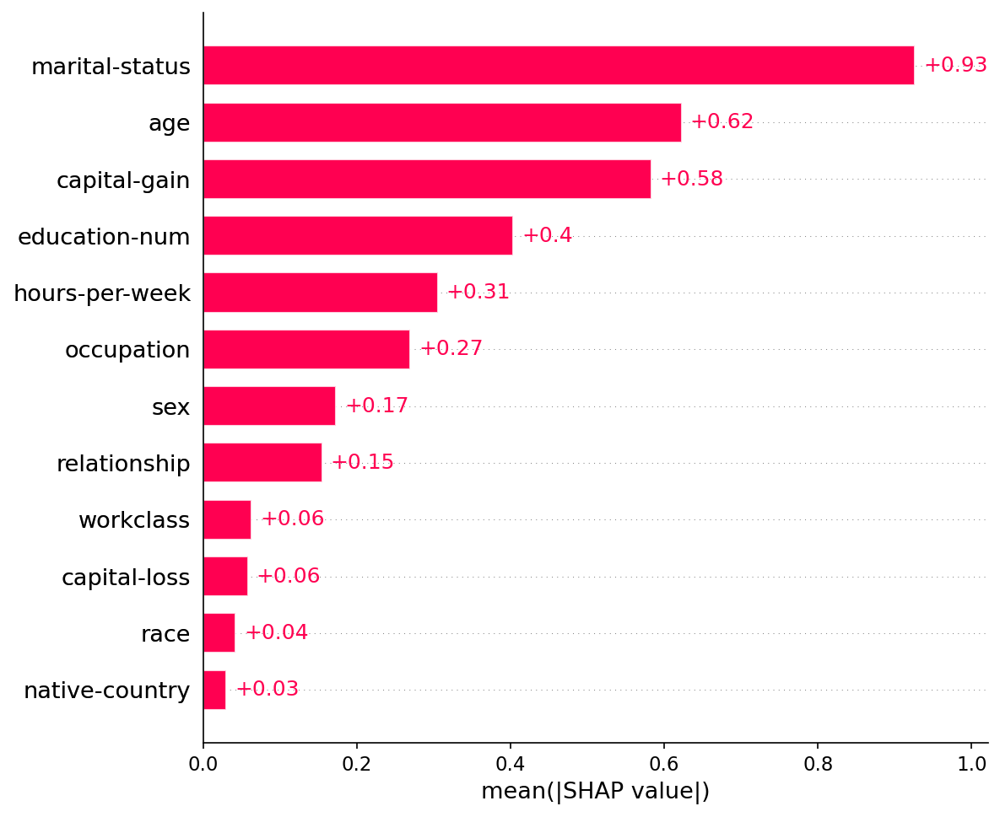
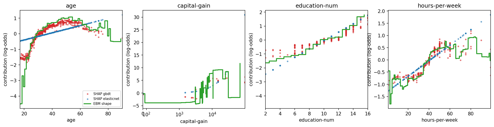
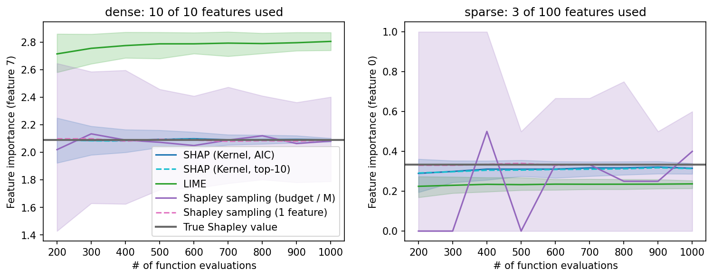

# Interpretable Regression & Explainability trên dữ liệu Adult

**Học phần:** Machine Learning and Applications — Topic 1.  
**Nhóm:** Đinh Trương Tuệ Linh (2570441), Đinh Thị Thu Thủy (2570508), Hứa Phước Trường (2580869).

> Bản thảo nguồn để nhóm học, đọc chéo và biên soạn báo cáo PDF 8–12 trang theo mục 5.1. Số liệu dưới đây thuộc artifact thực nghiệm của Thủy đã được merge về repository. Kiểm tra tính lại metric từ dự đoán không được xem là huấn luyện lại. Nhật ký chạy mới phải được trích riêng. Chưa xác nhận ngày nộp proposal, tỷ lệ đóng góp và hình thức trình bày; không điền giả các thông tin này.

## Tóm tắt

Nghiên cứu so sánh Logistic Regression với L1, L2, Elastic Net và GBDT trên Adult, kết hợp hệ số mô hình với giải thích SHAP. Các mô hình chính dùng 5-fold cross-validation, 12 cấu hình cho mỗi biến thể và ba random seed. Trong artifact của nhóm, GBDT đạt test ROC-AUC khoảng 0.9270 so với khoảng 0.9033–0.9035 của Logistic. Regularization thay đổi độ thưa rõ hơn hiệu năng. EBM được khảo sát bổ sung như một mô hình cộng tính phi tuyến; kết quả gần GBDT về mặt số học nhưng chưa chứng minh tương đương thống kê hoặc tính dễ hiểu đối với người dùng. Thí nghiệm SHAP trên bài toán nhỏ và cây tổng hợp minh họa local accuracy và hiệu quả mẫu dưới các giả định được công bố. Kết luận giới hạn trong dataset và protocol đã đo.

### Kiểm chứng baseline trên máy nhóm ngày 26/11/2026

Lần chạy `section4-baseline-20261126` dùng Logistic L2 với C=1, năm fold trên tập train và ba seed (42, 2026, 5175). Mỗi seed có một lần fit lại trên toàn bộ train và đánh giá trên cùng tập test chính thức của Adult. Test ROC-AUC đạt 0.903338696 ± 0.000000060 (mean ± sample std), trùng giá trị trung bình trong `results/baseline-1/test_summary.csv`. Average precision trung bình là 0.758015429, thấp hơn bản lưu khoảng 2.83 × 10⁻⁸. Chưa xác định nguyên nhân sai khác ở độ chính xác này. Độ lệch chuẩn qua seed mô tả biến thiên của quy trình fit trên cùng dữ liệu. Để kiểm tra, xem `baseline/test_metrics.csv`, `baseline/test_summary.csv` và `run.json` trong `results/reproductions/section4-baseline-20261126/`. Các kết quả tuning, ablation và SHAP dưới đây lấy từ các lần chạy đã lưu của nhóm.

## 1. Introduction

### 1.1. Bài toán và động cơ

Dữ liệu Adult được dùng để dự đoán nhãn thu nhập `>50K` từ các đặc trưng nhân khẩu học và công việc. Đây là phân loại nhị phân, phù hợp với Logistic Regression được nêu trong Topic 1. Mục tiêu học thuật không chỉ là tối đa hóa accuracy: nhóm cần hiểu mô hình sử dụng đặc trưng nào, vì sao các mô hình khác nhau và khi nào lời giải thích có thể thiếu ổn định. Dataset không được coi là bằng chứng cho khả năng triển khai quyết định đối với con người ngoài thực tế.

### 1.2. Các hướng tiếp cận và câu hỏi nghiên cứu

| Hướng | Ưu điểm | Giới hạn |
| --- | --- | --- |
| Logistic có regularization | Hàm dự đoán gọn, đọc hệ số và odds ratio; L1/Elastic Net có thể tạo nghiệm thưa | Tuyến tính trên log-odds; quan hệ phi tuyến cần thiết kế thêm đặc trưng |
| GBDT + SHAP | Học được quan hệ phi tuyến; khảo sát đóng góp theo từng quan sát | Ensemble khó đọc toàn bộ; attribution phụ thuộc cách định nghĩa giá trị nền/đặc trưng vắng mặt |
| EBM/GAM, GA2M | Biểu diễn bằng hàm một biến và một số tương tác | Nhiều hàm/bin vẫn cần người đọc kiểm tra; chi phí fit và kích thước không nhất thiết nhỏ |

RQ1: hiệu năng GBDT khác Logistic bao nhiêu và nhất quán qua seed không? RQ2: regularization ảnh hưởng thế nào đến hiệu năng và số hệ số hoạt động? RQ3: hệ số và SHAP đồng thuận/bất đồng ở đâu, và lời giải thích ổn định đến mức nào? Paper SHAP [1] là tài liệu tái hiện; InterpretML [2] cung cấp hướng mở rộng EBM. Nhóm phân biệt việc áp dụng SHAP trên Adult với tái hiện thí nghiệm của paper.

## 2. Methods / Approaches

### 2.1. Logistic Regression và regularization

Với $p_i=\sigma(b+x_i^T\beta)$, mục tiêu lý thuyết:

$$
\min_{b,\beta}-\frac{1}{n}\sum_i\{y_i\log p_i+(1-y_i)\log(1-p_i)\}
+\lambda\left(\alpha\|\beta\|_1+\frac{1-\alpha}{2}\|\beta\|_2^2\right).
$$

L1 ứng với $\alpha=1$, L2 ứng với $\alpha=0$, Elastic Net dùng giá trị trung gian; intercept không bị phạt. SAGA tối ưu mục tiêu bằng cập nhật gradient có giảm phương sai, xử lý thành phần L1 bằng bước proximal. `C` nhỏ làm regularization mạnh hơn; khi đối chiếu $\lambda$ cần giữ đúng cách chuẩn hóa loss của thư viện [3], không mặc định mọi biểu thức phần mềm đều dùng $\lambda=1/C$.

Hệ số biến số được đọc theo một độ lệch chuẩn train. Hệ số one-hot được đọc so với nhóm tham chiếu. Khi các biến khác giữ nguyên, odds nhân với $\exp(\beta_j)$ khi biến tăng một đơn vị. Đây là quan hệ trong mô hình, không phải kết luận nhân quả. Hệ số lớn không tự đồng nghĩa tầm quan trọng dự đoán lớn nếu đơn vị/phân bố biến khác nhau.

### 2.2. GBDT

GBDT xây dựng hàm điểm $F_T(x)=F_0+\eta\sum_{t=1}^{T}h_t(x)$; các cây được bổ sung theo hướng giảm loss, với xác suất lớp dương lấy qua sigmoid. Độ sâu cây, số cây và learning rate điều khiển độ phức tạp. So với Logistic không có đặc trưng tương tác, cây có thể biểu diễn ngưỡng và tương tác. So sánh hiệu năng chỉ gợi ý lợi ích của biểu diễn này, chưa tách được riêng tác động của từng thành phần.

### 2.3. SHAP và tái hiện

SHAP biểu diễn một dự đoán thành giá trị nền và tổng attribution. Nhóm giải thích GBDT/Logistic trên thang raw log-odds, kiểm tra sai số cộng tính và tổng hợp các cột one-hot theo biến gốc. Thí nghiệm paper gồm Figure 3 trên cây tổng hợp và Figure 4 trên hai trò chơi nhỏ. Cách tạo dữ liệu, reference và cách phân chia ngân sách sampling phải ghi riêng vì không đồng nhất hoàn toàn với paper [1]. Tổng attribution đúng không tự chứng minh mô hình dự đoán đúng hoặc lời giải thích mang ý nghĩa nhân quả.

### 2.4. EBM và kiểm tra ổn định

EBM được khảo sát với cấu trúc cộng tính $F(x)=b+\sum_j f_j(x_j)$ và phiên bản thêm hàm cặp $\sum_{j,k}f_{jk}(x_j,x_k)$. Hai cấu hình GAM/GA2M giúp khảo sát biểu diễn phi tuyến có thể đọc theo term [2]. Bootstrap train 30 lần đo thay đổi hệ số và thứ hạng SHAP khi refit với hyperparameter cố định; bootstrap test 1.000 lần đo chênh lệch metric có điều kiện trên các mô hình đã fit. Hai phép bootstrap trả lời hai câu hỏi khác nhau.

## 3. Experiments

### 3.1. Dữ liệu và chống rò rỉ

Artifact `data_check-1` ghi 32.561 mẫu train và 16.281 mẫu test từ tệp chính thức của Adult [4]. Nhãn dương lần lượt 7.841 và 3.846. Nhóm giữ bản ghi trùng (24 train, 5 test), bỏ `fnlwgt` và `education`, giữ `education-num`. Dữ liệu thiếu được impute median/mode; one-hot cho biến phân loại; Logistic chuẩn hóa biến số. Mỗi transformer được fit bên trong training fold. Giữ bản ghi trùng có thể tạo phụ thuộc giữa các fold; kết quả CV phải được diễn giải với giới hạn này.

Test độc lập với tuning. Validation là fold giữ lại trong Stratified 5-fold CV trên train. Seed 42, 2026, 5175 được dùng chung giữa mô hình. Khi tuning xong, refit toàn train và đánh giá test với threshold 0.5. Test không được dùng để chọn lại C, penalty hoặc cấu hình tốt nhất.

### 3.2. Baseline, ngân sách và môi trường

Baseline Logistic L2 `C=1` kiểm tra pipeline trước tuning, đạt test ROC-AUC xấp xỉ 0.9033 trong artifact `baseline-1`. Các mô hình chính thử 12 cấu hình × 5 fold mỗi seed: L1/L2 dùng 12 C log-spaced từ 0.001 đến 100; Elastic Net thử C ∈ {0.01, 0.1, 1, 10} và l1_ratio ∈ {0.2, 0.5, 0.8}; GBDT thử số cây {100, 200}, learning rate {0.03, 0.1}, độ sâu {2, 3, 4}. Chọn bằng ROC-AUC CV. Mỗi biến thể có ngân sách tương đương theo số lần fit; tổng ba biến thể Logistic không bằng một GBDT về ngân sách họ mô hình.

Artifact gốc ghi Ubuntu runner, 4 CPU, khoảng 15.6 GB RAM, Python 3.10, scikit-learn 1.7.2. Bản ghi đầy đủ nằm ở `env.json` của từng artifact. Thời gian tuning/refit/inference tách riêng. Số hệ số Logistic, số nút/lá GBDT và số term/bin EBM là các cách đếm khác nhau, không dùng chúng như một thước đo tham số đồng nhất.

### 3.3. Kết quả chính và sai số

Bảng đầy đủ sáu metric, mean ± sample std ba seed, được sinh từ CSV ở [evidence.md](evidence.md); script tính lại metric từ các dự đoán đã lưu và dừng nếu phát hiện sai lệch. Không chép lại thủ công một bảng khác rồi để hai nguồn lệch nhau.

GBDT đạt ROC-AUC khoảng 0.9270, AP 0.8248, F1 0.7068; Elastic Net tương ứng khoảng 0.9033, 0.7581, 0.6559. Cả ba biến thể Logistic gần nhau. Trên mô hình seed 42, bootstrap test cho chênh ROC-AUC GBDT − Elastic Net khoảng +0.0236 với khoảng percentile 95% [0.0212, 0.0261], từ `analysis-7/paired_bootstrap.csv`. Khoảng này có điều kiện trên dữ liệu test và mô hình đã fit, không bao gồm toàn bộ bất định huấn luyện, tuning hoặc dịch chuyển phân phối.

Std qua seed rất nhỏ vì một số cấu hình được chọn giống nhau và quá trình fit gần tất định. Đây không phải bằng chứng quần thể đã được ước lượng chính xác. Cũng không dùng std giữa fold CV trực tiếp làm khoảng tin cậy vì các fold dùng các tập train chồng lấn.

### 3.4. Ablation

Thay penalty L1/L2/Elastic Net tại C=1, cùng pipeline/seed/solver; Elastic Net dùng l1_ratio=0.5. Hiệu năng gần nhau nhưng số hệ số hoạt động khác nhau; bảng cụ thể nằm trong evidence. Ngưỡng hoạt động là $|\beta|>10^{-6}$. Thiết kế này tách khỏi bảng sau tuning: nó đo thay penalty tại một C cố định, không bảo đảm độ mạnh phạt hiệu dụng bằng nhau. Độ thưa không đủ để kết luận người dùng hiểu mô hình tốt hơn.

### 3.5. Giải thích và phân tích sai số

Artifact `explain-4` dùng background 100 mẫu train và 500 mẫu test cố định, thêm các trường hợp TP/TN/FP/FN và bất đồng. Sai số cộng tính lớn nhất khoảng $5.1\times10^{-8}$ với GBDT và $7.1\times10^{-15}$ với Logistic. `marital-status` đứng đầu ở cả hai; `age` đứng thứ hai ở GBDT và thứ bảy ở Logistic. Các khác biệt này mô tả cách hai mô hình sử dụng dữ liệu dưới lựa chọn background, không phải tầm quan trọng nhân quả của tuổi hoặc tình trạng hôn nhân.

Trường hợp dòng 47 có nhãn âm: GBDT dự đoán xác suất khoảng 0.15, Logistic khoảng 0.70; attribution `capital-gain` khác dấu. Trường hợp riêng lẻ minh họa sự bất đồng, không đại diện toàn bộ test. Dependence plot gợi ý các quan hệ phi tuyến ở age/capital-gain/hours-per-week. Đường shape của một term EBM GA2M chưa bao gồm các term tương tác nên không được đọc như toàn bộ ảnh hưởng của biến.

### 3.6. Tái hiện Figure 3 và Figure 4

Figure 4: trò chơi sickness cho attribution (1, 1, 0); trò chơi max với scores (5, 4, 0) cho (3, 2, 0). Kernel SHAP khớp phép tính Shapley chính xác; LIME của nhóm khác các số đọc từ hình paper. Nhóm báo cáo khác biệt về thiết lập lấy mẫu/kernel thay vì khẳng định tái hiện toàn bộ số liệu.

Figure 3: cây dense dùng 10 đặc trưng và cây sparse hướng tới 3/100 đặc trưng. Các lần lặp ở đây khảo sát nhiễu ước lượng explanation, không thay cho ba seed đánh giá mô hình chính. Lần 1 cấp toàn bộ ngân sách sampling cho một biến; lần 2 chia ngân sách cho M biến, đồng thời đổi điều kiện cây sparse và thêm biến thể Kernel SHAP. Do nhiều yếu tố thay đổi, kết luận về nguyên nhân chênh lệch phải dựa trên đối chứng cùng thiết lập, không chỉ so hai ảnh tổng quát.

Dải Kernel SHAP hẹp hơn sampling khi so ngân sách cho tất cả đặc trưng trong thiết lập này. Đó là kết quả tái hiện định tính dưới giả định công bố, chưa phải phục dựng chính xác code/dữ liệu paper. Các giá trị và chênh lệch chi tiết ở mục 6 của tài liệu analysis. Refactor đặt `sampling_budget` rõ trong từng config để chạy lại hai phiên bản có ý nghĩa như artifact ban đầu.

## 4. Improvement / application

EBM GAM đạt ROC-AUC khoảng 0.9267, GA2M khoảng 0.9272, gần GBDT 0.9270. Mỗi EBM chỉ chạy một cấu hình, khác ngân sách 12 cấu hình của mô hình chính; trình bày như phân tích bổ sung. Chưa tuning không biến điểm test thành “cận dưới”: tuning tiếp vẫn có thể làm test tốt hoặc xấu hơn.

Kết quả gợi ý hàm phi tuyến một biến thu hẹp phần lớn khoảng cách Logistic–GBDT trên Adult. Chưa đủ chứng minh tương tác không quan trọng hoặc EBM tương đương GBDT: khoảng tin cậy chênh lệch chứa 0 chỉ cho thấy chưa phân biệt được với thiết lập đó. Cần biên tương đương định trước nếu muốn kiểm định tương đương. Chưa có đánh giá người dùng nên không kết luận đánh đổi hiệu năng–khả năng hiểu đã biến mất.

Bootstrap train cho thấy thứ hạng SHAP tương đối ổn định trong protocol có điều kiện trên hyperparameter/background; không bao gồm tuning lại. Fairness theo sex/race dùng TPR, FPR, PPV và tỷ lệ chọn, kèm cỡ nhóm. Các nhóm ít ca dương cho ước lượng kém ổn định; chỉ ngưỡng 100 mẫu tổng chưa bảo đảm đủ mẫu số cho từng metric. Đây là phân tích mô tả, không phải chứng nhận mô hình công bằng.

## 5. Conclusion & limitations

RQ1: trong artifact nhóm, GBDT hơn Logistic trên các metric đã đo. RQ2: lựa chọn penalty tác động đáng kể đến độ thưa, trong khi hiệu năng gần nhau trong không gian tìm kiếm này. RQ3: mô hình đồng thuận ở một số biến nhưng khác thứ hạng và dạng đóng góp; explanation phụ thuộc cả dữ liệu, mô hình và lựa chọn reference.

Giới hạn gồm một dataset, bản ghi trùng được giữ, test cố định, chỉ ba seed, ngân sách tính theo số lần fit, EBM chưa tuning và các phân tích mở rộng được thiết kế sau khi xem kết quả. Không kết luận quan hệ nhân quả từ hệ số/SHAP. Bằng chứng phản biện cần được giữ nguyên khi chuyển sang slide/video; tránh rút gọn thành “EBM luôn tốt nhất” hoặc “SHAP giải thích nguyên nhân”.

## 6. References

1. Lundberg, S. M., & Lee, S.-I. (2017). [A Unified Approach to Interpreting Model Predictions](https://arxiv.org/abs/1705.07874).
2. Nori, H., Jenkins, S., Koch, P., & Caruana, R. (2019). [InterpretML: A Unified Framework for Machine Learning Interpretability](https://arxiv.org/abs/1909.09223).
3. scikit-learn 1.7. [Linear models](https://scikit-learn.org/1.7/modules/linear_model.html); [GridSearchCV](https://scikit-learn.org/1.7/modules/generated/sklearn.model_selection.GridSearchCV.html).
4. UCI Machine Learning Repository. [Adult](https://archive.ics.uci.edu/dataset/2/adult). Nguồn tải và checksum được lưu trong artifact `data_check-1`.
5. Đề bài học phần, `00_ML-Assignment-Topics.pdf`, Topic 1, mục 4 và mục 5.1.

## Phụ lục A. Khả năng tái lập và truy vết

Thực hiện theo [learning guide](../docs/learning_guide.md). `run_suite` lưu log và trạng thái từng bước vào thư mục riêng; `env.json` chứa hash code và môi trường. `reports.build_evidence` chỉ kiểm tra artifact cũ và tạo bảng, không huấn luyện. Cảnh báo hội tụ từng fold được bổ sung sau refactor, nên không khẳng định artifact cũ đã có log này. Kết quả chạy mới và so sánh phải được ghi trong [nhật ký refactor](../docs/refactor_validation.md).

## Phụ lục B. Phân công và AI

| Thành viên | Vai trò cần nhóm xác nhận | Đóng góp thực tế (%) |
| --- | --- | --- |
| Đinh Trương Tuệ Linh | Trưởng nhóm; học/tái hiện, tích hợp và report theo kế hoạch | Chưa xác nhận |
| Đinh Thị Thu Thủy | Mã thực nghiệm ban đầu và artifact được lưu trong dự án | Chưa xác nhận |
| Hứa Phước Trường | Cần thành viên xác nhận phần việc | Chưa xác nhận |

Nhóm tự thống nhất tỷ lệ dựa trên công việc thực tế, tổng 100%; không suy từ số commit. Claude Code hỗ trợ viết mã thực nghiệm ban đầu. README cũng ghi nhận GitHub Copilot hỗ trợ workflow. OpenAI Codex hỗ trợ proposal, khung phân tích, refactor, kiểm tra và bản thảo này. Mọi thành viên cần tự đọc, kiểm chứng số liệu và giải thích được công thức/code theo mục 4.4. Trước khi nộp, rút gọn/dàn trang PDF, kiểm tra hình và tài liệu tham khảo, xác nhận đóng góp và bổ sung slide/video theo phương án nhóm chọn.
